# Gate 3 — the picture

Richard asked for a run, not a mock-up, so the picture is the build: four screenshots of Open Bubble on a copy of
Puppy test 3 (a landing page with a puppy grid and an inquiry form, an admin page with CRUD, one collection), taken
headless at 1600×1000 on 2026-10-16. His yes or no is owed on these.

| | |
|---|---|
| 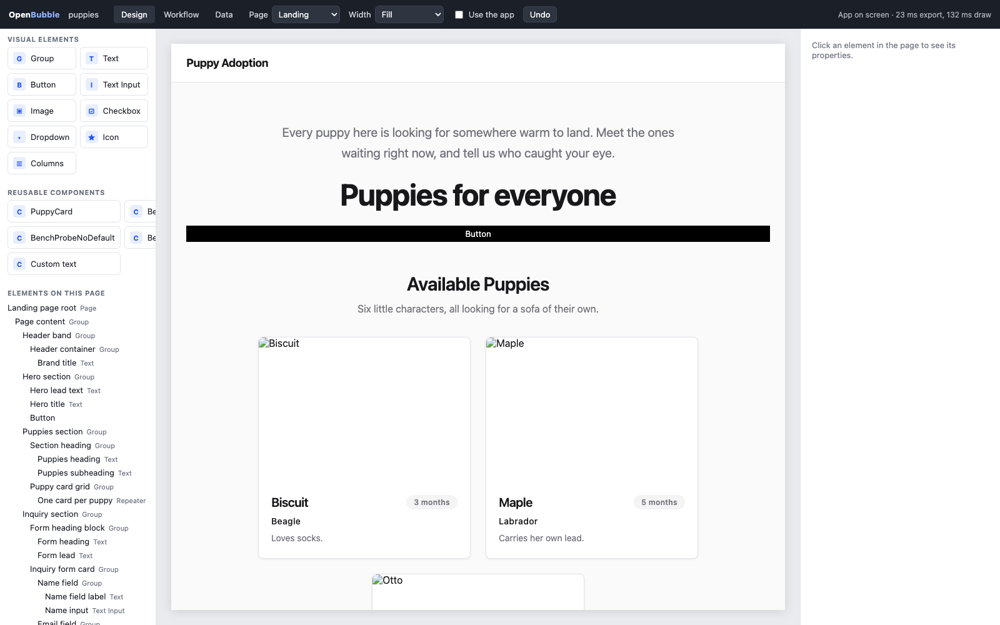 | **Design.** Palette and reusable components top-left, the page's element tree below; the real app in the middle (the width selector sets the viewport, *Use the app* lets clicks through); the property editor on the right once something is selected. |
| 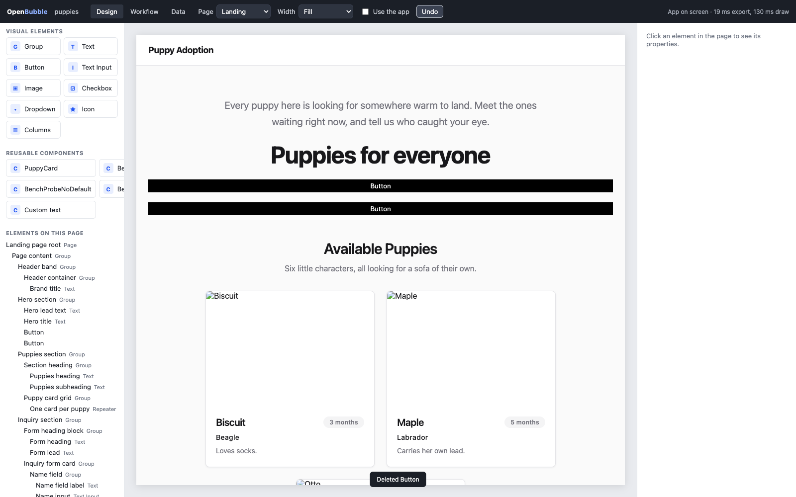 | **An element selected.** The blue box with its size tag and three handles; the tree row lit; the property editor shows the Text node's groups in the official editor's order (General, Text, Text Style, Style, Layout …) with the project's tokens as values. The hero lead was dragged above the title a moment earlier. |
| 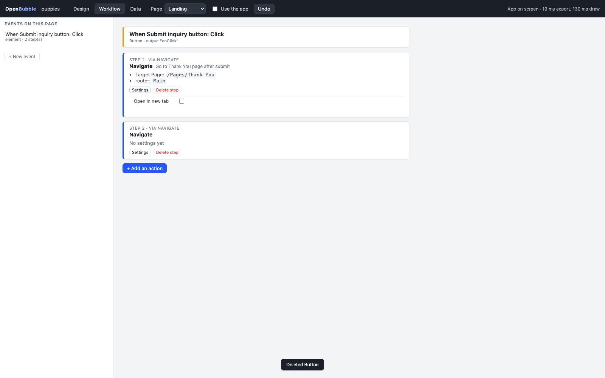 | **Workflow.** Events on the left (*When Submit inquiry button: Click*), the event card and its numbered steps in the middle; each step names the NodeGX node, its literal settings and the values wired into it; *Settings* opens the fields, *+ Add an action* appends a step wired from the one before. |
| 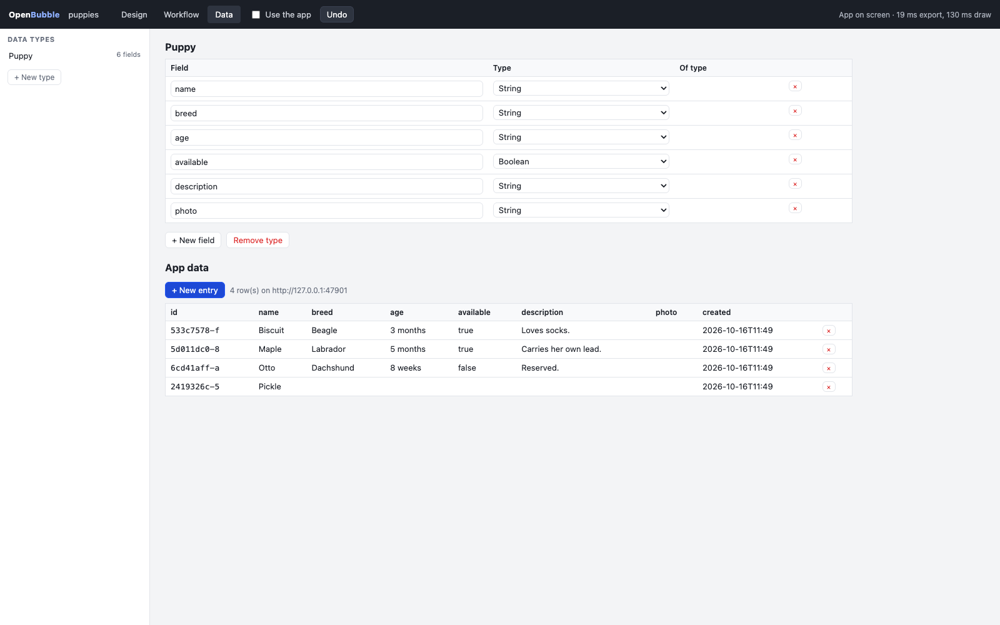 | **Data.** Types on the left; the selected type's fields (name, type, target type) editable in place and written to the project file; *App data* under it, the rows read from the bound backend, with new entry, inline edit and delete. |

## The mapping, Bubble → NodeGX

| Bubble | NodeGX, as this editor reads and writes it |
|---|---|
| page | a `page` component; its root `Page` node; the Router's `pages.routes` |
| element | a visual node in a parent's `children` (Group, Text, Button, Text Input, Image, …) |
| reusable element | a component placed as a node of type `/Components/<name>` |
| container: Row / Column / Align to parent / Fixed | a Group with `flexDirection` row / column; `position: absolute` |
| property editor | the node's `parameters`, by the runtime library's input ports |
| event ("When Button is clicked") | a signal output of a visual node (`onClick`) with at least one wire |
| action, step 1…n | the logic node a signal wire reaches, then its Done output's wire, and so on |
| "Input Name's value" in an action's field | a value wire from that node's output to the step's input |
| "Only when" | a Condition node in the chain |
| data type, field | `metadata.dbCollections[]` `{ name, columns: [{ name, type }] }` in `nodegx.project.json` |
| App data | the bound backend's `/classes/<type>` (Parse wire) |
| privacy rules | `nodegx.security.json` (not shown yet) |

## §built — the build held to the picture

Gate 4 is `editor/check.mjs`: PASS 17/17 on 2026-10-16 on a fresh copy of `templates/todo-list` with an ephemeral
backend started by the gate; every assertion reads the files on disk, the backend, or the app's own text, never the
editor's claim. README §3 lists each row and its measurement.

## s2 — the six things, mapped before they were built (2026-10-16)

The picture for s2 is the build again (Richard asked for the prep, then the run), so this section is the plan the
build is held to, feature by feature: what Bubble shows, what NodeGX already has for it, where it is written, and the
line in `editor/check.mjs` that says it works. The screenshots under §s2 built are what he says yes or no to.

| # | Bubble | NodeGX underneath | written where | the gate reads |
|---|---|---|---|---|
| 1 | a conditional step that **branches** the workflow in two (FlutterFlow's If, which Bubble never had; its "Only when" is one greyed clause per step) | a `Condition` node: `eval` is the step's trigger, `ontrue` and `onfalse` are two chains that never rejoin; its `condition` input is wired from an Expression's `result` | the page's `nodes.json` / `connections.json` through the store (add_node, connect) | a branch added after step 1 is a Condition on disk wired from step 1's Done; an action added in its **No** column is wired from `onfalse`; the Yes column stays empty |
| 2 | **option sets**: fixed lists with typed attributes, loaded with the app | a logic component `Option sets/<Name>` holding one `Static Data` node (`type: json`, `json: [...]`) wired to `Component Outputs` (Items, Count); the attributes in the component's `metadata.optionSet`; a page reads it by placing an instance (`/Option sets/<Name>`) and wiring Items | `components/Option sets/<Name>/*` through `writeComponent(expectNew)`; `_registry.json` by the store | a set with two attributes and two options exists as that component on disk, its Static Data's JSON holds both rows; after the page is rebuilt the app validates |
| 3 | the **expression composer** (chips: *Current User's email is not …*), or **pure JS**, or **both** | the `Expression` node: its text is JavaScript, every free name is an input port (the spec's `expressionPorts`); a chip is a name wired from the element value it stands for; `result` is wired to the field being composed | an Expression node per composed field, labelled for the field; `connections.json` for the chips and the result | composing *Name input's Text + " !"* writes an Expression whose text reads a name, that name wired from the input's `onTextChanged`, `result` wired to the field; the JS view shows the same text; typing in the JS view keeps the chips whose names it still reads |
| 4 | **custom states** on an element (type, name, default, list) | a `Variable2` node named `<Element>.<state>`, its `value` parameter the default, `metadata.customState = { of: <elementId>, type, list }`; read in the composer as *Element's state*; set by a `Set Variable` step whose `name` is fixed | the page's `nodes.json` | adding a state *count* to the card writes a Variable2 with that metadata; it appears in the composer's sources as *Sign-in card's count*; a *Set state* action writes a Set Variable with `name` equal to it |
| 5 | **global styles** per element type (Filled Dark Primary …), set on an element | the format's `variants` in `nodegx.styles.json` (`{ name, typename, parameters }`, the Looks of P81), worn by a node's `variant` field; the preview's export already carries them | `nodegx.styles.json` (written as JSON, as the project file is); the node's `variant` through a `set_variant` edit kept beside the store's eight | *Save as a style* on a Button writes a variant with its parameters; picking it on a second Button writes `variant` on that node and the app draws the second as the first |
| 6 | **the red distance lines** with px values on hover, padding and margin shown | the live element's `getComputedStyle` (padding, margin) and its rect against its parent's content box | nothing: an overlay only | the overlay carries four distance labels for the selected element whose numbers equal the rect difference the gate computes itself |

**The chrome.** One typeface (Inter, from the system font stack if offline), a 4 px grid, an icon rail on the left
(Design, Workflow, Data, Styles) as Bubble has, panels with 12 px padding and 1 px hairlines, a property editor whose
groups are flat with a 96 px label column, popovers (the action picker, the source picker, the composer) with a
search box, grouped headings in small caps and keyboard focus, the status in the header reduced to what a person
needs (saved · app on screen), the rest on hover.

**Not in s2, by design:** privacy rules; "Set as default" for a style; the composer's `:filtered`/`:sorted`
operators (the JS view is where that goes); Bubble's Conditional tab on an element (NodeGX has state parameters
for it; a ruling first); a custom state that is a list (`list: true` is stored, the Variable holds an array,
the composer does not index into it yet).

### §s2 built — the pictures (headless, 1600×1000, on a copy of `templates/todo-list`, taken by `check.mjs --shots`)

| | |
|---|---|
| 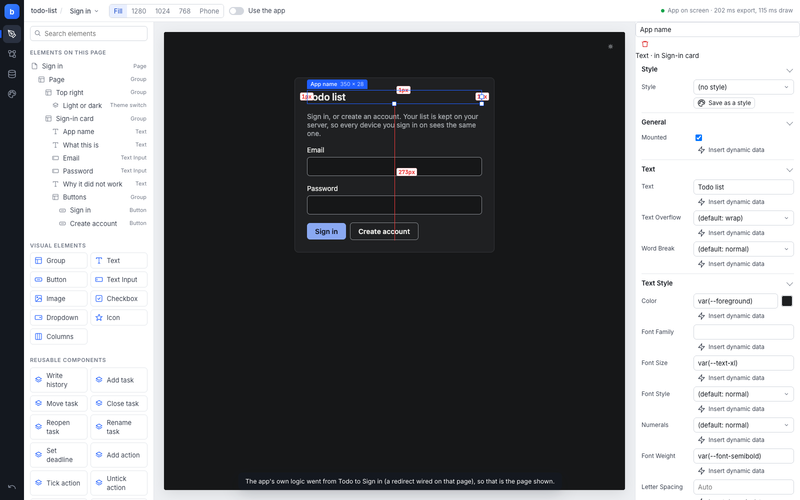 | **Design.** The icon rail, the tree with element glyphs, the real app; the selected title with its size tag and handles and the red distance lines to the card's content box; the property editor with *Style* at the top (the variant select, *Save as a style*). |
| 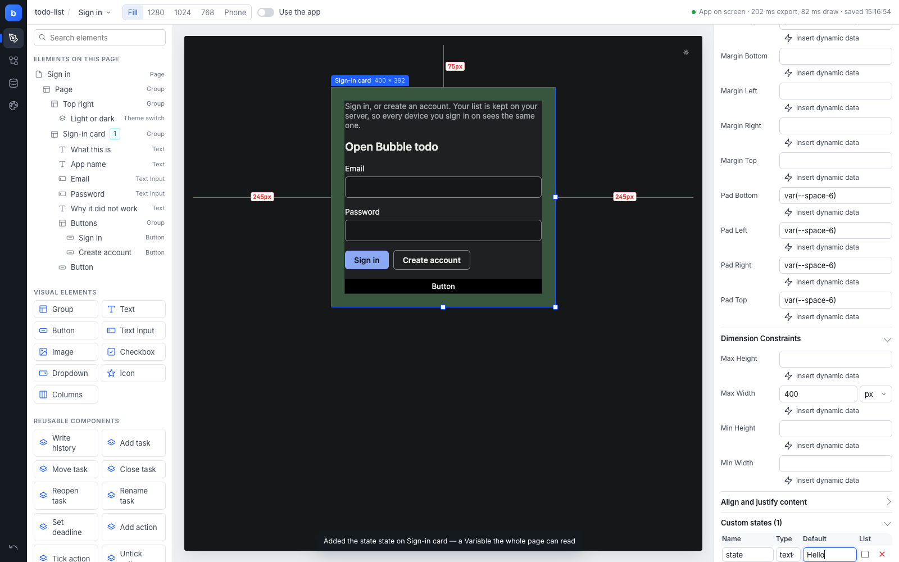 | **Custom states.** The card's states as a table under its properties (name, type, default, list); the tree shows a count chip on the element. |
| 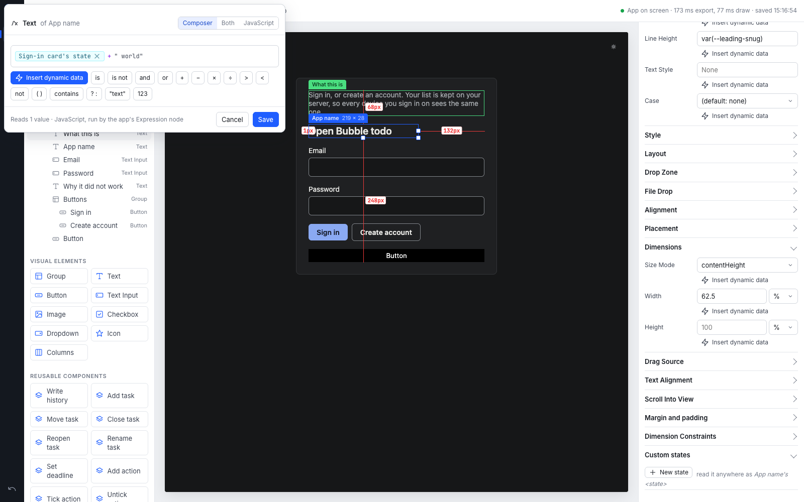 | **The composer.** *Text of App name*: the Composer view with the state as a chip, `+` and `" world"`; the Both / JavaScript views are the same text. The foot says what it reads and whether it compiles. |
| 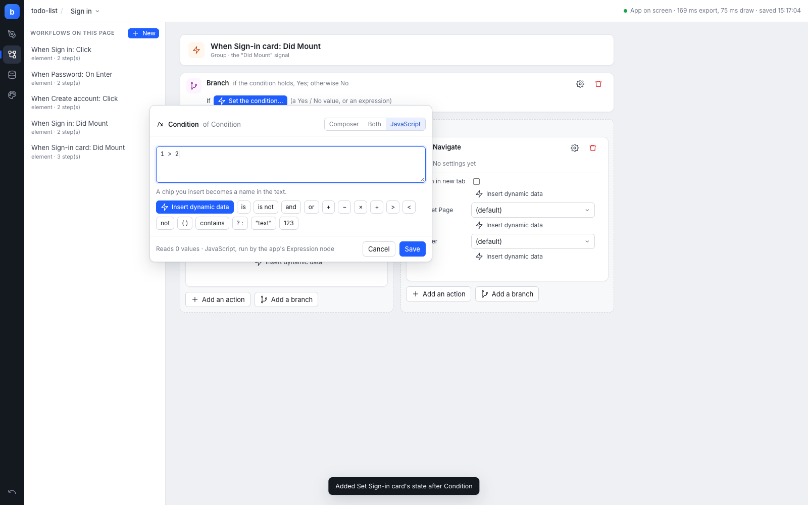 | **A branch.** *When Sign-in card: Did Mount* → Branch; the Yes column holds *Set Sign-in card's state*, the No column a Navigate, each with its own add row; the condition being composed as JavaScript. |
| 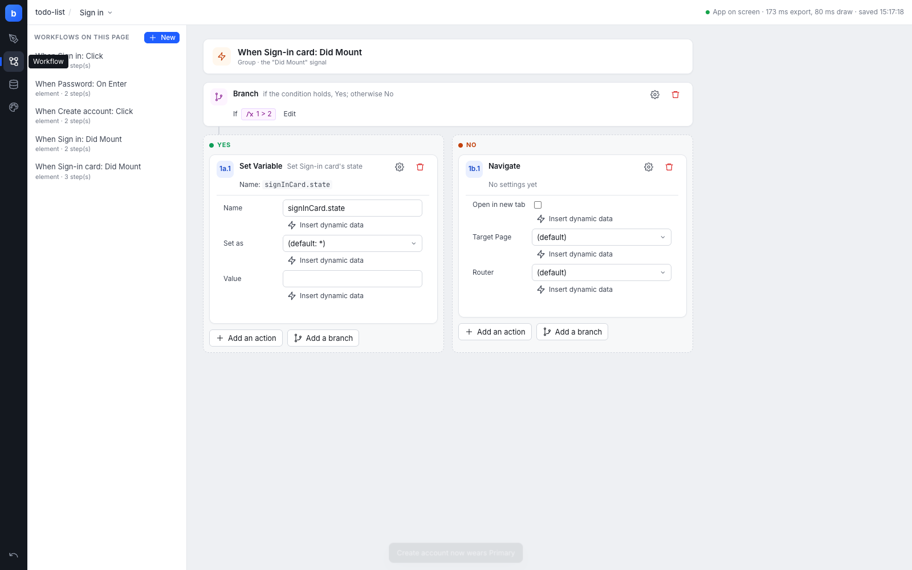 | **Workflow.** The workflows on the page with their step counts; the event card and numbered steps with a settings cog and delete per step. |
| 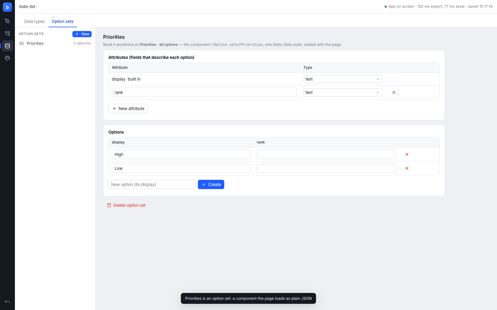 | **Option sets.** *Priorities*: attributes (display built in, rank) and options as tables; the sentence says what it is underneath (a component, one Static Data node, loaded with the page). |
| 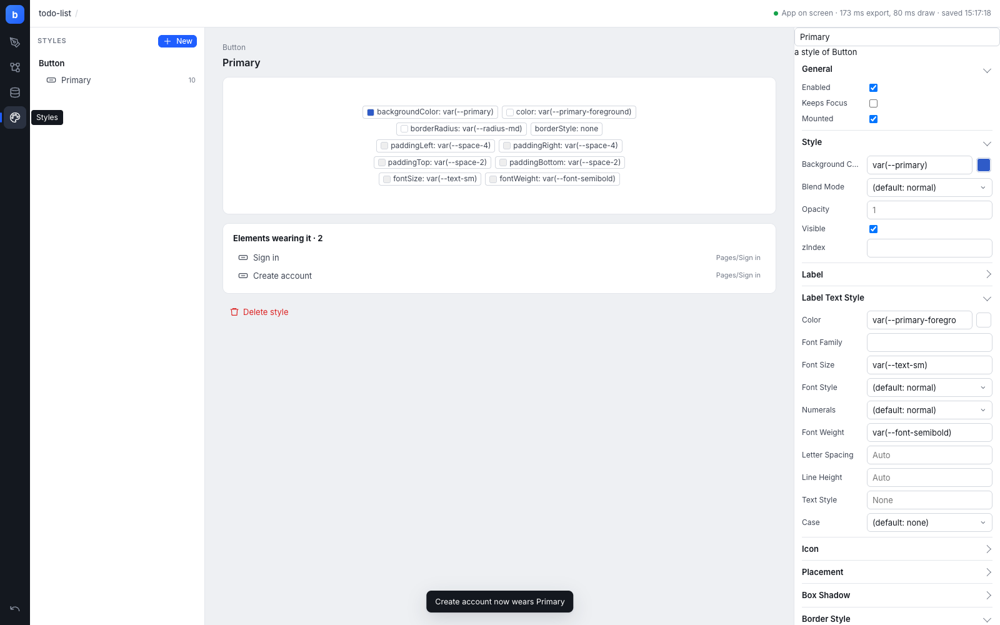 | **Styles.** *Primary*, a style of Button: its properties as chips (colour swatches resolved), the two elements wearing it, the variant's parameters editable on the right. |
| 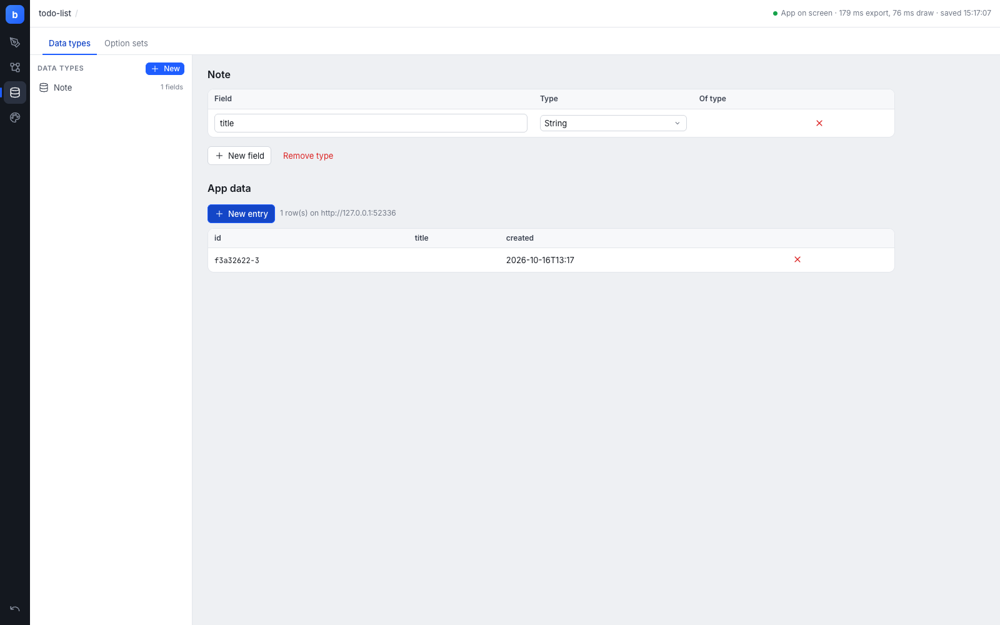 | **Data.** Types and fields, the rows on the bound backend. |
